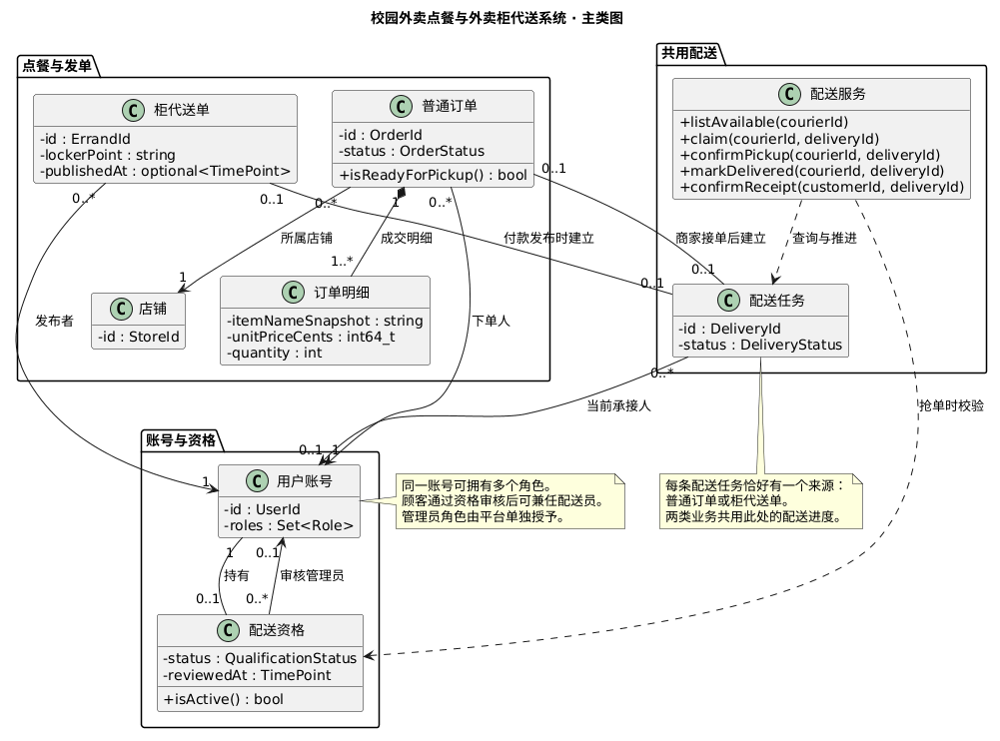
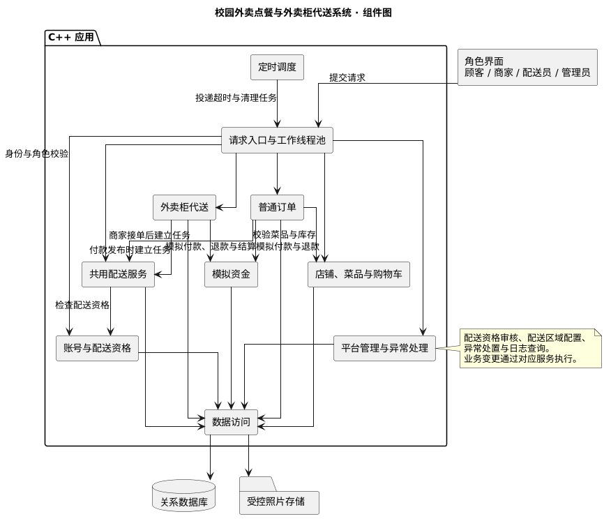
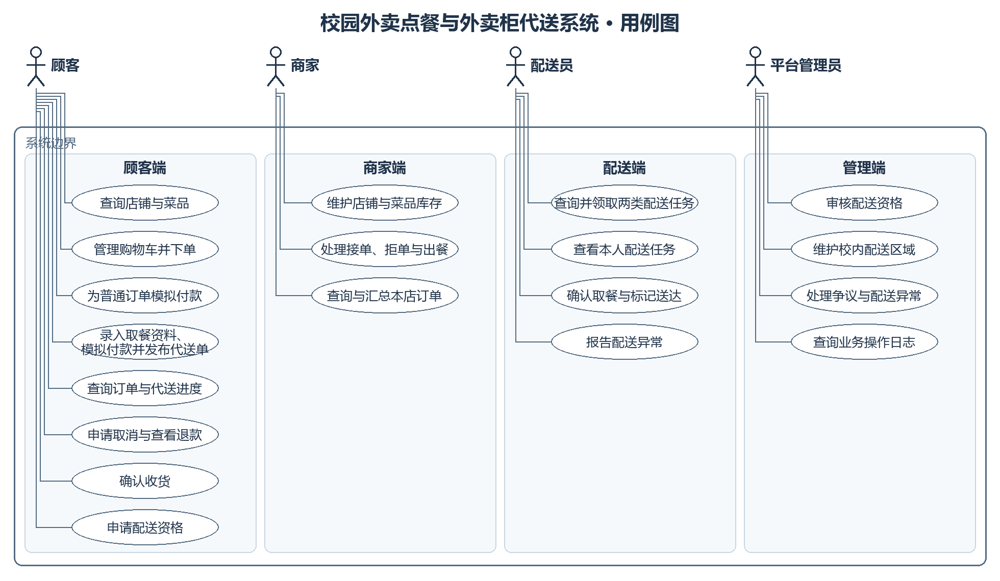
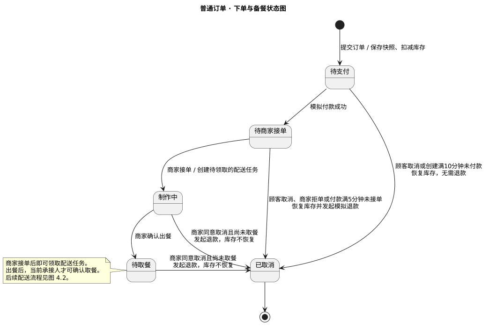
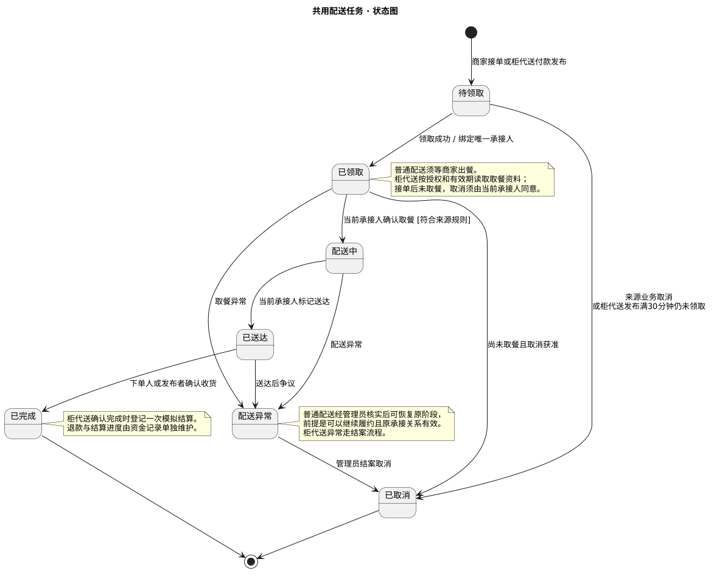
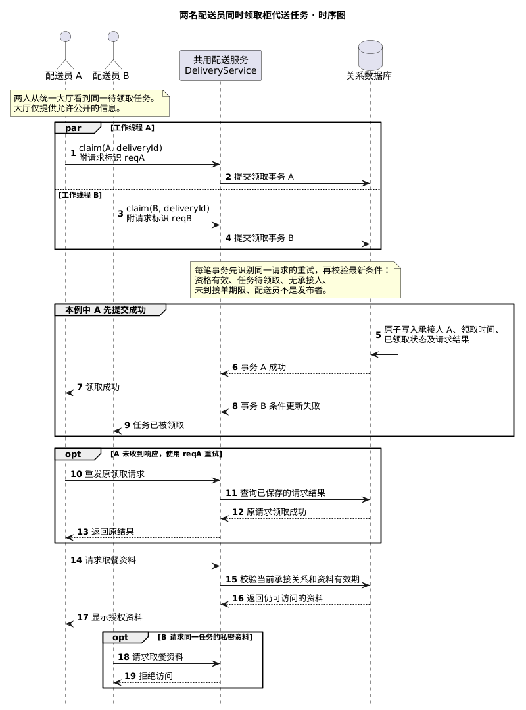

# 实验二：软件设计与建模

**项目**　校园外卖点餐与外卖柜代送系统  
**姓名**　陈昕宇　　**学号**　241840098

## 目录

1. 软件的主要功能
   - 主要功能
   - 功能模块
2. 软件架构 UML 图
   - 类图
   - 组件图
   - 用例图
   - 状态图
     - 普通订单下单与备餐
     - 共用配送任务
   - 时序图
3. UI 界面及功能描述
4. 大模型及辅助工具的使用
   - 使用过程记录
   - 思考与总结

## 一　软件的主要功能

### 1　主要功能

根据实验一的需求分析，本项目设计一套面向校内的外卖点餐与配送系统。系统支持两种场景。一是顾客向校内商家点餐，商家接单制作后由配送员送达。二是顾客为已放入校内外卖柜的外部餐品发布代送单，由配送员到柜点取餐并送达。两类业务共用配送大厅、领取和送达流程。

- **普通点餐**。顾客可按店铺、关键词、菜品分类或价格等条件查询，管理购物车并按店铺分别结算。订单保存成交明细与配送信息。商家可维护店铺营业状态和菜品库存，处理接单、拒单与出餐，并查询和汇总本店订单。
- **外卖柜代送**。顾客录入柜点、取餐码、送达地址、联系方式和配送费，可选填照片。模拟付款成功后发布代送单，发布满 30 分钟仍无人领取时取消并发起退款。取餐码和照片按权限及有效期访问。
- **配送与收货**。具备有效资格的配送员可在统一大厅查询并领取两类任务。当前承接人确认取餐并标记送达，原下单人或发布者确认收货。普通点餐须等商家出餐后才能取餐。
- **账号与平台管理**。系统按顾客、商家、配送员和管理员划分操作权限。学生可用原顾客账号申请兼任配送员。管理员负责资格审核、配送区域维护、异常和争议处理，并可查询业务日志。
- **模拟资金与订单处理**。系统记录模拟付款、退款和柜代送结算。顾客可查询订单进度和退款结果，并在符合条件时取消或申请取消。系统通过定时任务处理待支付、待接单超时及资料到期。柜点资料由顾客手工录入，资金流程在系统内模拟。

### 2　功能模块

| 功能模块 | 主要职责 |
| --- | --- |
| 账号与配送资格 | 管理角色和操作权限，记录配送资格申请与审核结果。 |
| 店铺、菜品与购物车 | 管理营业状态、菜品价格和库存，提供组合查询与按店铺结算。 |
| 普通订单 | 校验下单条件、保存成交快照，处理付款后的商家接单、备餐、取消与超时。 |
| 外卖柜代送 | 管理柜代送发布、接单期限及取餐资料，按任务状态和权限处理取消。 |
| 共用配送服务 | 汇集符合领取条件的任务，统一处理抢单、取餐、送达和确认收货。 |
| 模拟资金 | 保存付款、退款和柜代送结算记录，处理重复请求。 |
| 平台管理与异常处理 | 维护配送区域，受理争议与异常，提供审核入口和日志查询。 |

系统拟用 C++ 实现。请求入口将顾客、商家、配送员和管理员的操作交给工作线程池，定时调度投递超时及清理任务。各业务模块通过数据访问层保存状态，抢单等并发操作在提交时校验最新记录。具体依赖和调用过程见第二部分。

## 二　软件架构 UML 图

### 1　结构性图（一）　类图
·

*图 1.1　校园外卖点餐与外卖柜代送系统主类图*

1. **用户账号（`UserAccount`）**  
   保存用户编号和角色集合。同一个学生账号可以用于点餐和发布柜代送单，取得有效配送资格后也可以领取配送任务。管理员角色由平台单独授予。

2. **配送资格（`DeliveryQualification`）**  
   记录配送资格的状态、审核时间和审核人。每个用户账号最多持有一份配送资格。配送服务在抢单时调用 `isActive()` 检查资格是否有效。

3. **店铺（`Store`）**  
   表示校内提供餐品的店铺。每笔普通订单归属一家店铺，同一家店铺可以对应多笔订单。

4. **普通订单（`Order`）**  
   记录顾客向校内店铺提交的订单及其业务状态，并关联下单人、店铺和成交明细。商家接单后，系统为订单建立配送任务。配送员领取后，系统通过 `isReadyForPickup()` 检查商家是否已出餐，再决定是否允许确认取餐。

5. **订单明细（`OrderItem`）**  
   保存成交时的菜品名称、单价和数量。一笔普通订单由一条或多条明细组成，单价以分为单位保存。商家后来修改菜品名称或价格时，历史订单仍可按成交时的信息查询。

6. **柜代送单（`Errand`）**  
   记录顾客为已放入外卖柜的餐品发起的代送请求，保存柜点和发布时间，并关联发布者。顾客完成模拟付款并发布后，系统建立配送任务。

7. **配送任务（`DeliveryTask`）**  
   保存配送任务编号和配送状态，并关联至多一名当前承接人。待领取时承接人为空，领取成功后关联配送员账号。普通订单和柜代送单各自最多关联一条配送任务，每条已建立的配送任务恰好来自其中一种业务。

8. **配送服务（`DeliveryService`）**  
   提供查询可领取任务、抢单、确认取餐、标记送达和确认收货等操作。配送员通过同一入口查询和领取两类任务。取餐和送达由当前承接人操作，收货由原下单人或发布者确认。

**类之间的关系与设计理由**

普通订单和柜代送单分别建模，因为前者涉及店铺、成交明细和商家制作，后者涉及柜点和取餐资料。两类业务进入配送环节后，共用 `DeliveryTask` 记录配送进度，共用 `DeliveryService` 处理操作。普通订单的商家进度和配送进度可以分别表达。例如，配送员在商家制作期间领取订单后，系统可以同时显示“商家制作中”和“配送员已领取”，并在出餐后开放确认取餐操作。

主类图集中展示账号资格、业务单与配送任务之间的关系。配送状态的转换条件在状态图中展开，多个配送员同时领取同一任务时的处理过程在时序图中说明。

### 2　结构性图（二）　组件图

*图 2.1　校园外卖点餐与外卖柜代送系统组件图*

1. **角色界面与请求入口**  
   顾客、商家、配送员和管理员从各自的界面发起操作。C++ 应用统一接收请求，校验账号身份和角色，再由工作线程池执行相应业务。一次请求执行完毕后即可释放线程，后续操作根据已保存的进度继续处理。

2. **账号与配送资格**  
   管理账号角色及配送资格。配送服务在领取任务时检查资格是否有效。学生可用同一账号点餐和接单，管理员通过审核操作管理配送资格。

3. **店铺、菜品与购物车**  
   负责店铺营业状态、菜品维护、组合查询和购物车。普通订单模块在提交时重新校验店铺、菜品和库存，并保存成交快照。

4. **普通订单与外卖柜代送**  
   普通订单模块管理下单、商家接单和制作，商家接单后建立配送任务。外卖柜代送模块管理柜点、发布和取餐资料，在模拟付款成功并发布时建立配送任务。两类业务分别处理各自的发单条件，并把可领取任务交给共用配送服务。

5. **共用配送服务**  
   对应主类图中的 `DeliveryService`。负责统一大厅查询、领取、确认取餐、标记送达和确认收货。两个工作线程可以同时处理同一任务的领取请求，由数据访问模块在事务中执行条件更新，保证只有一名配送员成功领取。普通订单取餐还需满足出餐条件，柜代送取餐资料按权限和有效期读取。

6. **模拟资金与平台管理**  
   模拟资金模块保存付款、退款和结算记录。平台管理模块提供配送资格审核、配送区域配置、异常处置及日志查询。管理员的业务操作由对应服务校验并执行，相关业务状态和资金记录按需在同一事务中更新。

7. **定时调度与数据访问**  
   定时调度向请求入口投递订单超时、代送超时和资料清理任务，由对应模块按最新状态处理。数据访问模块统一管理关系数据库和受控照片存储，保存业务状态与关联记录。

**模块交互与设计理由**

系统将普通点餐和外卖柜代送保留为两个业务模块，两者在各自满足发单条件后调用共用配送服务。这样的划分允许两条流程保留各自的校验规则，同时复用抢单、取餐和送达操作。应用内的工作线程池可以并行处理用户请求和到期任务。订单、库存及模拟资金等关联变更可以通过同一数据库事务提交，便于处理并发与重试。

### 3　行为性图（一）　用例图

*图 3.1　校园外卖点餐与外卖柜代送系统用例图*

1. **顾客**  
   顾客可查询店铺和菜品、管理购物车并按店铺提交普通订单，也可以填写柜点与取餐资料，支付模拟配送费后发布柜代送单。顾客可以查询本人订单和代送进度、申请取消与查看退款，并在配送员标记送达后确认收货。学生顾客还可用同一账号申请配送资格。

2. **商家**  
   商家维护本店资料、营业状态及菜品价格和库存，处理接单、拒单和出餐，查询并汇总本店订单。商家接单后，普通订单进入配送待领取列表。商家出餐后，已领取该任务的配送员才能确认取餐。

3. **配送员**  
   配送资格有效的人员可从统一大厅查询并领取普通配送或柜代送任务。领取成功后，配送员可以查看本人任务、确认取餐、标记送达或报告异常。柜代送的取餐资料按权限和有效期展示。

4. **平台管理员**  
   管理员负责配送资格审核、校内配送区域维护、争议与配送异常处理及业务日志查询。配送任务日常由配送员自主领取。

**用例划分与设计理由**

点餐和柜代送保留各自的发单入口，配送员统一通过“查询并领取配送任务”进入后续流程，对应主类图中的共用配送服务。图中按角色划分用例。柜代送的模拟付款作为发布用例的一部分展示，因为付款成功后才能发布。普通订单提交后可以进入待支付状态，因此将下单和模拟付款分别列为用例。

### 4　行为性图（二）　状态图

#### 4.1　普通订单下单与备餐状态图

*图 4.1　普通订单下单与备餐状态图*

本图展示普通订单从提交到备餐完成的状态。订单依次进入待支付、待商家接单、制作中和待取餐。商家接单时创建待领取的配送任务，配送员可以在制作期间领取。领取只改变配送任务的状态，出餐后当前承接人才可确认取餐。

待支付的 10 分钟从订单创建起算，超时取消时恢复库存，无需退款。待商家接单的 5 分钟从模拟付款成功起算，超时取消时恢复库存并发起模拟退款。商家接单后、配送员取餐前的取消须由商家同意。进入制作中后按已制作处理，获准取消时发起模拟退款，库存不再恢复。商家未出餐导致无法履约时，可登记异常并由管理员核实处理。

#### 4.2　共用配送任务状态图

*图 4.2　共用配送任务状态图*

普通订单在商家接单后进入待领取，柜代送单在模拟付款并发布后进入待领取。之后两类任务共用领取、取餐、送达和确认流程。普通订单在取餐、送达及确认收货时，与配送任务同步更新相关状态。柜代送发布后 30 分钟无人领取时取消并全额模拟退款。已领取但尚未取餐时，柜代送取消须经当前承接人同意。取餐异常或无法送达时，管理员按业务来源处理，柜代送异常结案为已取消，并按规则裁定退款或结算。

**状态划分与并发处理**

拆成两张图可以分别表示普通订单的商家进度和共用配送进度。例如，商家制作中时配送任务已经可以处于已领取。柜代送发布前尚未建立配送任务，发布后从配送任务读取配送进度。退款与结算的执行结果由资金记录单独保存。抢单与超时取消、取餐与批准取消可能同时到达，服务在提交时按最新状态核对转换条件，只有仍符合条件的操作才能生效。

### 5　交互性图　时序图

*图 5.1　两名配送员同时领取柜代送任务时序图*

1. **并发提交**  
   两名配送员从统一大厅看到同一条待领取任务，分别提交任务编号和请求标识。两个 C++ 工作线程可同时调用主类图中的 `DeliveryService::claim()`，请求标识随请求传递。

2. **校验并提交领取**  
   服务识别重复请求，并按事务中的最新数据检查配送资格、任务状态、承接人、接单期限和发布者身份。领取成功时，承接人、领取时间、已领取状态和请求结果一并保存。图中以 A 先提交成功为例，B 的条件更新未成功，收到任务已被领取的提示。若 30 分钟超时取消先提交，领取条件也会失效。

3. **重试与凭证访问**  
   A 在未收到响应时可使用原请求标识重试，系统返回原结果。领取成功后，取餐资料通过独立请求读取，服务检查当前承接关系和资料有效期。B 无权读取该任务的私密资料。

**交互设计理由**

两类配送共用同一个领取入口和唯一承接规则。时序图选择柜代送作为示例，因为它还涉及接单期限、发布者回避和私密取餐资料授权。大厅查询与领取之间可能出现状态变化，最终结果由提交时的状态校验和原子更新决定。

## 三　UI 界面及功能描述

*待补充顾客端、商家端、配送端和管理员端的界面及说明。*

## 四　大模型及辅助工具的使用

### 1　使用过程记录

*按实际使用顺序填写。每次使用单独记录，可按下列模板增补。*

| 记录项 | 本人填写 |
| --- | --- |
| 使用时间、工具和使用场景 | |
| 提供给工具的任务、需求依据或约束 | |
| 生成结果及对应文件 | |
| 结果的优点、问题及核对依据 | |
| 本人的判断、修改过程和修改理由 | |
| 优化后的结果及对应 Git 提交 | |

### 2　思考与总结

- **工具适合辅助哪些设计工作**  
  *本人填写。*
- **哪些设计判断仍需要人工参与**  
  *本人填写。*
- **能否采用由工具生成、人工只做检查校对的流程，以及适用条件和局限**  
  *本人填写。*
